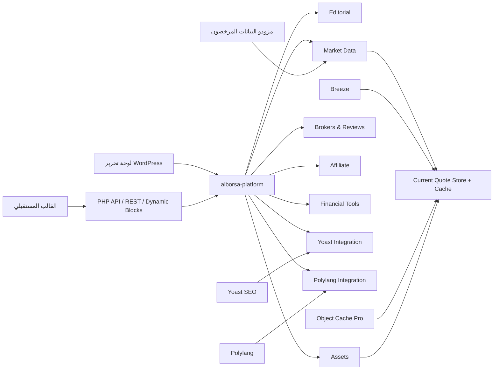

# معمارية إضافة alborsa-platform

> الحالة في 2026-09-16: نُفذت طبقة Foundation فقط. أسماء الواجهات والمسارات والجداول الخاصة بوحدات المنتج تظل مقترحات وليست وظائف موجودة حالياً.

## حالة تنفيذ Foundation

المسار الحالي: `wp-content/plugins/alborsa-platform/`.

العقود المنفذة:

- Namespace: `Alborsa\Platform` مع Composer PSR-4.
- الحد الأدنى المعلن في Plugin header هو WordPress `6.6` وPHP `8.1`؛ لم يُنفذ بعد Compatibility smoke test على مصفوفة WordPress حية.
- `Module` و`ModuleRegistry` لتسجيل الوحدات بالترتيب مرة واحدة؛ المسجل الآن هو `FoundationModule` فقط.
- إصدار migration محفوظ في option باسم `alborsa_platform_db_version`، والإصدار الحالي `1` لا ينشئ جداول.
- قفل مؤقت باسم `alborsa_platform_migration_lock` يمنع تشغيل migration متزامنة، ويُحذف عند التعطيل بدون حذف الإصدار أو الصلاحيات.
- Capability باسم `manage_alborsa_platform` تضاف إلى `administrator` فقط.
- اختبارات Site Health بالمعرفين `alborsa_platform_dependencies` و`alborsa_platform_migrations`.
- أمر WP-CLI: `wp alborsa health`، ويرجع خطأ عند نقص تكامل إنتاج مطلوب أو تأخر migration.
- فحص Soft dependencies يعتمد على حالة التفعيل أو Runtime marker فقط. لا يعد فحصاً للإصدار أو الترخيص أو الإعداد أو صحة الخدمة.

لم تُنشأ Types أو REST routes أو جداول أو Feature implementations لأي وحدة منتج.

## 1. الهدف

الإضافة هي طبقة المنتج الخاصة بمنصة البورصة. وظيفتها إدارة المحتوى المنظم، بيانات الأسواق، مراجعات الوسطاء، المقارنات، روابط الأفلييت، الأدوات المالية، والعلاقات بينها. يجب أن تعمل هذه الوظائف بصرف النظر عن القالب المستخدم.

المبدأ الحاكم:

> القالب يقرر كيف تظهر البيانات، والإضافة تقرر ما هي البيانات وكيف تُدار وتُحمى وتُحدَّث.

## 2. حدود المسؤولية

### مسؤولية الإضافة

- تسجيل أنواع المحتوى والتصنيفات والحقول.
- فرض الصلاحيات وقواعد التحقق من المدخلات.
- إدارة بيانات السوق ومصادرها ووقت تحديثها.
- تقديم واجهات قراءة مستقرة للقالب عبر PHP وREST API وDynamic Blocks.
- إدارة مراجعات الوسطاء والتقييمات والمقارنات.
- إدارة روابط الأفلييت وتسجيل الضغطات الآمنة.
- تنفيذ معادلات الأدوات المالية واختبارها.
- ربط الأخبار والتحليلات بالأصول.
- التكامل مع إضافة SEO بدون تكرار الـ Schema أو Canonical.
- توفير أدوات استيراد وتشخيص ومراقبة.

### مسؤولية القالب لاحقاً

- Layout، Typography، Colors، Spacing وResponsive behavior.
- قوالب الأرشيف والصفحات المفردة.
- الشكل النهائي للبطاقات والجداول والتيكر والمقارنة.
- أماكن الإعلانات المرئية.
- الحركات والتفاعلات البصرية.

### مسؤولية الخدمات الخارجية

- أسعار وبيانات الأسواق المرخصة.
- Widgets العرض التابعة لطرف ثالث.
- البريد والنشرات.
- التحليلات وإدارة الموافقة والإعلانات.

### سياسة الاعتماد على الإضافات الموجودة

| الإضافة | نوع العلاقة | سلوك `alborsa-platform` عند غيابها |
|---|---|---|
| Polylang | مطلوبة في بيئة الإنتاج للغات | لا يحدث Fatal error؛ تتوقف خصائص اللغة ويظهر تنبيه إداري |
| Yoast SEO | مطلوبة في بيئة الإنتاج للـSEO | لا يحدث Fatal error؛ لا تطبع الإضافة Graph بديلاً تلقائياً قبل قرار صريح |
| Breeze | توافق تشغيلي | تعمل الإضافة، لكن يفشل فحص جاهزية الكاش حتى تراجع الإعدادات |
| Object Cache Pro | تحسين بنية الكاش | تستخدم WordPress Object Cache API وتعمل بدون Persistent cache مع تحذير أداء |
| Antispam Bee | تكامل اختياري للتعليقات | تبقى الحماية الداخلية وModeration إلزاميتين |
| WP 2FA | حماية تشغيلية مستقلة | لا تتدخل الإضافة في المصادقة ولا تتجاوز سياسات 2FA |
| WPS Hide Login | توافق مع رابط الدخول | تستخدم الإضافة WordPress login URL APIs فقط |

الإصدارات الظاهرة في لقطة 2026-09-15 هي نقطة بداية للاختبار وليست Compatibility matrix معتمدة قبل تشغيل الاختبارات.

## 3. نمط البناء

سيتم بناء الإضافة كـ **Modular Monolith**:

- حزمة WordPress واحدة.
- Namespace واحد: `Alborsa\Platform`.
- كل وحدة تمتلك خدماتها وقواعدها وواجهاتها.
- التواصل بين الوحدات يتم من خلال Services وContracts معلنة، وليس باستدعاءات عشوائية أو Global state.
- لا يتم إدخال Framework أو Service Container ثقيل؛ يكفي Bootstrap/Registry صغير وصريح.



## 4. الوحدات

### قواعد الاعتماد بين الوحدات

- `Foundation` لا يعتمد على أي وحدة منتج.
- `MarketData` يعتمد على هوية الأصل من `Assets` ولا يعدل محتواه التحريري.
- `Affiliate` يستطيع قراءة هوية الوسيط من `Brokers` ولا يعدل تقييمه.
- `FinancialTools` يمكنه قراءة سعر موحد من `MarketData` عبر Contract فقط.
- `Editorial` ينشئ العلاقات من خلال Relationship service، ولا يكتب في جداول وحدة أخرى مباشرة.
- `SeoIntegration` يقرأ Read Models عامة ولا يصبح مصدراً مستقلاً للبيانات.
- `MultilingualIntegration` يعرّف ما يترجم وما ينسخ عبر Polylang، ولا يغيّر المحتوى بنفسه.
- لا يسمح لأي وحدة بقراءة جدول مخصص لوحدة أخرى مباشرة؛ التبادل يمر عبر Service/Repository معلن.
- أي Event داخلي يأخذ Prefix ثابتاً مثل `alborsa_platform/` ويضاف إلى سجل العقود عند تنفيذه.

### 4.1 Foundation

مسؤوليتها:

- تشغيل الإضافة وإيقافها.
- تسجيل الوحدات بالترتيب الصحيح.
- إدارة إصدار قاعدة البيانات والترقيات.
- Feature flags للمزايا غير الجاهزة.
- تسجيل الأخطاء بشكل آمن.
- التكامل مع Site Health وWP-CLI.

لا تحتوي على منطق خاص بالأسواق أو الوسطاء.

### 4.2 Editorial

مسؤوليتها:

- الأخبار والتحليلات والدروس والمصطلحات.
- ربط المحتوى بالأصول والوسطاء والموضوعات.
- بيانات الكاتب والمراجع والمصادر وتاريخ المراجعة.
- حالة المحتوى: مسودة، مراجعة تحريرية، مراجعة امتثال، منشور.
- إدخال RSS كمسودات فقط، مع منع النشر التلقائي افتراضياً.
- إظهار متطلبات الإفصاح والتنبيه المالي للقالب.

### 4.3 Assets

مسؤوليتها:

- السجل الرئيسي للأصول: سهم، مؤشر، فوركس، سلعة، كريبتو.
- أكواد الأصل لدى كل مزود بيانات.
- السوق والعملة والقطاع ومعرّفات مثل ISIN إن وُجدت.
- العلاقات مع الأخبار والتحليلات.
- حالة الأصل وإتاحته للعرض والفهرسة.

### 4.4 Market Data

مسؤوليتها:

- تعريف Contracts موحدة لمزودي البيانات.
- سحب البيانات في الخلفية على دفعات.
- التحقق والتطبيع قبل الحفظ.
- حفظ أحدث Snapshot مع المصدر ووقت التحديث ونوع التأخير.
- إرجاع آخر قيمة سليمة عند تعطل المزود مع وسمها كبيانات قديمة.
- عدم تنفيذ أي طلب خارجي أثناء بناء صفحة Frontend.
- Dashboard لصحة المزود وآخر نجاح وأخطاء التزامن.

العقود المستهدفة:

| العقد المقترح | المدخل | المخرج المتوقع | المسؤولية |
|---|---|---|---|
| `QuoteProviderInterface` | مجموعة رموز خاصة بالمزود | دفعة Quotes مطبعة أو خطأ معروف | جلب الأسعار الرقمية المرخصة |
| `ReferenceDataProviderInterface` | طلب مزامنة أو Cursor | دفعة بيانات أصول مرجعية | مزامنة الشركات والرموز والخصائص الثابتة |
| `EmbedProviderInterface` | رمز الأصل وسياق العرض | إعداد Embed مصرح به | عرض Widget فقط بدون اعتبارها API بيانات |

`EmbedProviderInterface` منفصل عمداً: ويدجت العرض لا يُعامل كمصدر API ولا تُنسخ بياناته إلى قاعدة البيانات.

### 4.5 Brokers

مسؤوليتها:

- ملف الوسيط وخصائصه المنظمة.
- تقييم تحريري متعدد المحاور.
- نقاط القوة والضعف والرسوم والمنصات وطرق الإيداع.
- التراخيص مع اسم الجهة ورقم الترخيص ورابط المصدر وتاريخ التحقق.
- المقارنة بين وسيطين أو ثلاثة.
- مراجعات المستخدمين وحالات التحقق والمراجعة اليدوية.
- عدم توليد شارة تنظيمية من نص حر؛ الشارات مشتقة من بيانات موثقة.

التقييم التحريري منفصل دائماً عن متوسط تقييم المستخدمين.

### 4.6 Affiliate

مسؤوليتها:

- تعريف العروض والوجهات المسموح بها.
- روابط مختصرة داخلية مثل `/go/{slug}`.
- Redirect آمن إلى نطاق موجود في Allowlist.
- إضافة UTM/Sub-ID وفق العرض والحملة.
- تسجيل ضغطة بدون تخزين بيانات شخصية غير ضرورية.
- تقارير أساسية حسب الوسيط والصفحة والحملة.
- Expiration وإيقاف العروض بدون تعديل كل المقالات.

### 4.7 Financial Tools

مسؤوليتها في الإصدار الأول:

- حاسبة الزكاة.
- حاسبة نمو الاستثمار.
- حاسبة Pip.
- حاسبة حجم الصفقة.
- حاسبة الربح والخسارة.
- محول العملات.

قواعد التنفيذ:

- كل معادلة Pure Service قابلة لاختبار Unit Test.
- التقريب والعملات والمدخلات معرفة صراحة.
- لا يتم حفظ مدخلات المستخدم افتراضياً.
- شرح الافتراضات والنتيجة جزء من Contract الأداة.
- القالب مسؤول لاحقاً عن شكل النموذج والنتيجة.

### 4.8 SEO Integration

مسؤوليتها:

- توفير البيانات الدلالية لـYoast SEO عبر واجهاته الموثقة.
- اعتبار Yoast SEO المالك الوحيد للـCanonical وMeta robots وSitemaps والـSchema graph.
- إضافة الكيانات المالية المطلوبة إلى Graph الخاص بـYoast، بدلاً من طباعة JSON-LD مستقل ومكرر.
- `noindex` لصفحات المقارنة الناتجة من Query Parameters والفلاتر المؤقتة.
- Schema مخصص فقط عندما لا يغطيه Yoast، وبعد التحقق من مطابقته للمحتوى الظاهر.
- إدراج المصدر، الكاتب، المراجع، تاريخ النشر وتاريخ آخر مراجعة في البيانات المتاحة للقالب وSEO.

مرجع التنفيذ المستقبلي: [Yoast Schema integration guidelines](https://developer.yoast.com/features/schema/integration-guidelines/). لا تُثبت أسماء Hooks في الكود قبل مراجعة الوثائق المتوافقة مع الإصدار المثبت وقت التنفيذ.

### 4.9 Multilingual Integration

مسؤوليتها:

- تسجيل أنواع المحتوى والتصنيفات العامة ككيانات قابلة للترجمة في Polylang.
- تعريف الحقول المحايدة التي تنسخ بين الترجمات، والحقول التحريرية التي تبقى مستقلة.
- ضبط Query language صراحة في المهام الخلفية والاستيراد، وعدم افتراض لغة الطلب الحالي.
- منع hard-code للمسار `/ar/` أو بناء روابط اللغة عن طريق دمج Strings.
- إبقاء الإنجليزية غير منشورة حتى بدء مرحلتها، بدون تغيير معرفات الأصول أو علاقاتها.

سيستخدم التكامل Filters الرسمية المناسبة مثل `pll_get_post_types` و`pll_get_taxonomies` عند الحاجة، وسيحدد نسخ Meta المنتقاة باستخدام `pll_copy_post_metas` أو `wpml-config.xml` الذي يدعمه Polylang. المراجع: [Custom Post Types and Taxonomies](https://polylang.pro/documentation/support/guides/multilingual-custom-post-types-and-taxonomies/) و[Synchronize metadatas](https://polylang.pro/documentation/support/guides/synchronize-metadatas-between-translations/).

## 5. الحقول ولوحة الإدارة

- تسجل الحقول الأساسية باستخدام WordPress Metadata APIs مع تعريف النوع، الصلاحية، والتعرض للـREST.
- لا يعتمد نموذج البيانات على ACF أو Page Builder.
- يمكن استخدام ACF لاحقاً لتحسين تجربة التحرير فقط، بشرط أن يقرأ ويكتب نفس المفاتيح والعقود.
- الحقول المركبة الحرجة، مثل التراخيص وأكواد المزودين، تدار من واجهات Admin خاصة مع Validation واضح.
- الاستيراد الجماعي يمر عبر Service نفسها المستخدمة في لوحة الإدارة؛ لا يكتب CSV importer في الجداول مباشرة.

## 6. واجهات الإضافة مع القالب

ستقدم الإضافة ثلاث طبقات، مع بقاء منطق المنتج في مكان واحد:

1. PHP Query/Service API لقوالب WordPress.
2. REST API للبيانات التي تحتاج تحديثاً مستقلاً عن Page Cache.
3. Dynamic Blocks بمخرجات HTML دلالية قليلة التنسيق.

مسارات REST المستهدفة عند تنفيذ وحداتها:

```text
GET  /wp-json/alborsa/v1/assets
GET  /wp-json/alborsa/v1/assets/{id}
GET  /wp-json/alborsa/v1/assets/{id}/quote
GET  /wp-json/alborsa/v1/brokers
GET  /wp-json/alborsa/v1/brokers/compare?ids=1,2,3
POST /wp-json/alborsa/v1/brokers/{id}/reviews
GET  /go/{affiliate-slug}
```

لا يُسمح للـREST API بإرجاع مفاتيح مزودين أو روابط داخلية حساسة أو بيانات تحقق خاصة بالمراجعين.

## 7. الأداء والكاش

- تحديث السوق يتم من Scheduled jobs حقيقية عبر Server Cron/WP-CLI؛ لا نعتمد على زيارة المستخدم لتشغيل WP-Cron.
- أحدث الأسعار تحفظ في جدول مخصص وتُنسخ إلى Object Cache Pro عبر WordPress Object Cache API.
- يستخدم Cache group خاص بالمنصة ومفاتيح Versioned، مع حذف المفاتيح المتأثرة فقط.
- لا تستدعي الإضافة Full Object Cache Flush أثناء مزامنة الأسعار أو حفظ المحتوى.
- لا تعتمد الخطة على مزايا Object Cache Pro 2.x لأن الإصدار المرصود في الصورة هو `1.25.5`.
- صفحات المحتوى قابلة للـFull Page Cache عبر Breeze.
- السعر المتغير يُجلب كجزء صغير مستقل ولا يتسبب في Purge لكل صفحات الموقع.
- Endpoints العامة ترسل Cache headers تناسب درجة حداثة البيانات.
- عند فشل المزود نظهر آخر قيمة سليمة مع `as_of` و`stale=true` بدلاً من رقم فارغ أو غير موثوق.
- لا نخزن Tick history في WordPress ضمن الـMVP.
- يستثنى `/go/*` من Page Cache حتى تسجل كل ضغطة Affiliate قبل التحويل.
- تتم مراجعة Cache behavior الفعلي لمسارات REST والأسعار، ثم تضاف الاستثناءات اللازمة في Breeze وVarnish إن كان مفعلاً.
- تحديث Quote لا ينفذ Purge شاملاً لـBreeze أو Varnish؛ تحديث المحتوى التحريري فقط هو الذي يبطل الصفحات المرتبطة.

يدعم Breeze قواعد Never Cache للروابط الديناميكية حسب [وثائق Cloudways](https://support.cloudways.com/en/articles/5126470-how-to-install-and-configure-breeze-wordpress-cache-plugin). لا تستخدم الإضافة Cache purge API قبل التحقق من إعداد المصادقة وعدم كشف مفاتيحه.

## 8. الأمان والخصوصية

- Capability check لكل إجراء إداري.
- Nonces للنماذج الداخلية، مع Server-side rate limiting وHoneypot للنماذج العامة.
- Antispam Bee طبقة مساعدة لتعليقات WordPress، لكنه لا يعتبر حماية عامة للـREST endpoints أو التسجيل.
- توافق Antispam Bee مع `alb_broker_review` وطريقة الإرسال يجب اختباره قبل الاعتماد عليه؛ وإلا يضاف Turnstile أو مزود حماية آخر بقرار منفصل.
- WP 2FA يحمي تسجيل دخول فريق الإدارة فقط بعد تفعيل سياسة الإلزام؛ وجود الإضافة Active لا يثبت أن السياسة مطبقة.
- إضافتنا لا تنشئ Login URL ولا تفترض أن `wp-login.php` متاح؛ تستخدم WordPress login URL APIs حتى تبقى متوافقة مع WPS Hide Login.
- Sanitization عند الإدخال وEscaping عند العرض وPrepared SQL للجداول المخصصة.
- مفاتيح API في Environment variables أو `wp-config.php`، وليس داخل Git.
- Allowlist صارمة للـAffiliate redirects لمنع Open Redirect.
- عدم السماح بحقن HTML قادم من مزود البيانات.
- عدم حفظ IP كامل في تقارير الأفلييت؛ إن لزم منع التكرار يستخدم Hash محدود المدة.
- دعم أدوات WordPress لتصدير/حذف بيانات مراجعات المستخدمين.
- عملية Uninstall لا تحذف بيانات المنصة افتراضياً؛ الحذف يحتاج اختياراً صريحاً.

## 9. تعدد اللغات

- جميع النصوص البرمجية تستخدم Text Domain: `alborsa-platform`.
- لا يتم hard-code للمسار `/ar/` داخل الكود.
- المعرّفات المحايدة مثل ISIN ورمز المزود تُنسخ بين اللغات.
- العناوين والوصف والمحتوى والمزايا والعيوب قابلة للترجمة.
- Polylang هو مكوّن تعدد اللغات المعتمد حالياً.
- يضاف `wpml-config.xml` عند بدء التكامل لتحديد الحقول المنسوخة والمترجمة؛ اسم الملف معيار توافق يدعمه Polylang ولا يعني استخدام إضافة WPML.
- يعتمد `/ar/` على إعداد Polylang باستخدام Directory language code مع عدم إخفاء كود اللغة الافتراضية؛ يجب التحقق من الإعداد على الموقع قبل اعتماد الروابط نهائياً.
- الإنجليزية Feature flag مغلق حتى المرحلة المخصصة لها.

مرجع إعداد الروابط: [Polylang URL modifications](https://polylang.pro/documentation/support/guides/url-modifications/).

## 10. هيكل الملفات

الجزء المنفذ من Foundation:

```text
wp-content/plugins/alborsa-platform/
├── alborsa-platform.php
├── composer.json
├── config/
│   ├── capabilities.php
│   ├── dependencies.php
│   └── modules.php
├── src/
│   ├── Plugin.php
│   └── Foundation/
│       ├── Activation.php
│       ├── AdminNotice.php
│       ├── Deactivation.php
│       ├── DependencyChecker.php
│       ├── FoundationModule.php
│       ├── HealthCommand.php
│       ├── MigrationRunner.php
│       ├── Module.php
│       ├── ModuleRegistry.php
│       ├── NetworkSiteIds.php
│       ├── RoleCapabilities.php
│       └── SiteHealth.php
└── tests/
    ├── Unit/
    └── Integration/
```

الهيكل المستهدف عند بدء وحدات المنتج:

```text
wp-content/plugins/alborsa-platform/
├── alborsa-platform.php
├── composer.json
├── readme.txt
├── config/
│   ├── capabilities.php
│   ├── dependencies.php
│   └── modules.php
├── languages/
├── src/
│   ├── Plugin.php
│   ├── Foundation/
│   ├── Shared/
│   └── Modules/
│       ├── Editorial/
│       ├── Assets/
│       ├── MarketData/
│       ├── Brokers/
│       ├── Affiliate/
│       ├── FinancialTools/
│       ├── SeoIntegration/
│       └── MultilingualIntegration/
├── blocks/
├── templates/
├── tests/
│   ├── Unit/
│   ├── Integration/
│   └── Fixtures/
└── wpml-config.xml
```

مجلد `templates` يقتصر على Fallback markup وظيفي وقابل للوصول، وليس التصميم النهائي.

## 11. جودة الكود والتشغيل

- Composer وPSR-4 autoloading.
- WordPress Coding Standards.
- PHPStan بمستوى يتم تشديده تدريجياً.
- PHPUnit للمعادلات والتطبيع والصلاحيات والترقيات.
- Contract tests لكل مزود بيانات باستخدام Fixtures محفوظة لا API حي.
- WP-CLI commands للاستيراد، التزامن، إعادة المحاولة، وفحص الحالة.
- CI يشغل lint، static analysis، unit tests وintegration tests.
- كل تغيير في الجداول يمر عبر Migration قابلة لإعادة التشغيل بأمان.

## 12. ما لن تفعله الإضافة في الـMVP

- تنفيذ نظام عضويات أو دفع.
- تخزين تاريخ لحظي للأسعار.
- تقديم نصائح أو توصيات استثمارية شخصية.
- توليد محتوى مالي آلي ونشره بدون مراجعة بشرية.
- Scraping لمواقع السوق أو الوسطاء.
- ربط مباشر بمنصة تداول أو تنفيذ أوامر.
- التحكم في التصميم النهائي للقالب.
