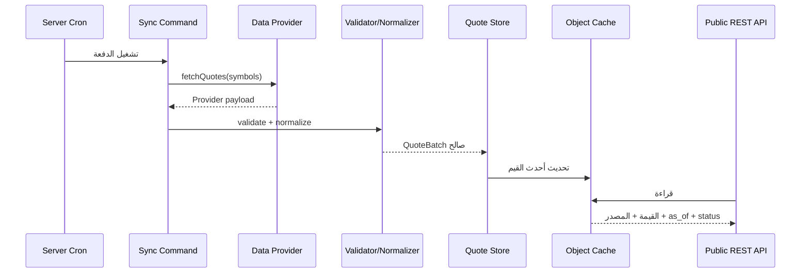

# نموذج بيانات منصة البورصة

> الحالة: نُفذ جدول العلاقات `{$wpdb->prefix}alb_relationships` عبر Migration الإصدار 2 وجدول أحدث الأسعار `{$wpdb->prefix}alb_market_quotes` عبر الإصدار 4، وسُجلت أنواع المحتوى `alb_analysis` و`alb_guide` و`alb_asset` والتصنيفات الأساسية المرتبطة بها. باقي الجداول وأنواع المحتوى والتصنيفات تظل عقوداً مقترحة قبل التنفيذ.

## 1. قاعدة الاختيار

- نستخدم WordPress Posts/Terms/Meta للمحتوى التحريري الذي يحتاج تحريراً ومراجعات وترجمة.
- نستخدم جداول مخصصة للبيانات كثيرة التحديث أو الأحداث المتزايدة، مثل الأسعار الحالية وضغطات الأفلييت.
- لا نستخدم `postmeta` لتخزين time-series أو سجلات كبيرة.

## 2. أنواع المحتوى

الأسماء البرمجية المقترحة أقل من 20 حرفاً وتبدأ بـ`alb_` لتجنب التعارض، بما يتفق مع قيد مفاتيح Post Types في [WordPress](https://developer.wordpress.org/reference/functions/register_post_type/).

| النوع | المفتاح | الغرض | المرحلة |
|---|---|---|---|
| خبر | WordPress `post` | الأخبار والتغطية اليومية | MVP |
| تحليل | `alb_analysis` | التحليل الفني والأساسي | MVP — منفذ |
| دليل تعليمي | `alb_guide` | الدروس والمسارات التعليمية | MVP — منفذ |
| مصطلح | `alb_glossary` | المسرد العربي/الإنجليزي | MVP/P1 |
| أصل مالي | `alb_asset` | الأسهم والمؤشرات والفوركس والسلع والكريبتو | MVP — منفذ |
| وسيط | `alb_broker` | الملف والمراجعة التحريرية | MVP |
| مقارنة تحريرية | `alb_compare` | صفحات مقارنة أو «أفضل الوسطاء» القابلة للفهرسة | MVP/P1 |
| اكتتاب | `alb_ipo` | الاكتتابات القادمة والسابقة | P1 |

الأدوات ليست Posts مستقلة منطقياً؛ تسجل في `ToolRegistry` ويرتبط كل Tool بصفحة WordPress تحريرية للشرح والـSEO.

## 3. التصنيفات

| التصنيف | يرتبط بـ | أمثلة |
|---|---|---|
| `alb_topic` | خبر، تحليل، دليل | أسهم، فوركس، اقتصاد، تمويل إسلامي — منفذ |
| `alb_asset_type` | أصل | stock، index، forex، commodity، crypto — منفذ |
| `alb_exchange` | أصل | Saudi Exchange، ADX، DFM — منفذ |
| `alb_sector` | أصل | بنوك، طاقة، اتصالات — منفذ |
| `alb_broker_type` | وسيط | forex، stocks، crypto |
| `alb_jurisdiction` | وسيط | السعودية، الإمارات، المملكة المتحدة |
| `alb_guide_level` | دليل | مبتدئ، متوسط، متقدم — منفذ |
| `alb_guide_track` | دليل | الأسهم، الفوركس، التحليل، الاستثمار الحلال — منفذ |

التصنيفات المنفذة متاحة في لوحة الإدارة وREST القياسي، لكن أرشيفاتها العامة وRewrite rules الخاصة بها معطلة حتى تعتمد عقود روابطها. يستخدم مسار تداول slug النوع `stock` وسوق `tadawul`، ويستخدم مسار الفوركس slug النوع `forex`.

الجهة التنظيمية ليست Taxonomy فقط؛ نحتاج سجلاً منظماً لكل ترخيص داخل الوسيط لأن رقم الترخيص والرابط وتاريخ التحقق تختلف.

## 4. حقول الأصل المالي

### تعريف ثابت

- `alb_canonical_symbol` — منفذ ومتاح في REST القياسي.
- `alb_base_currency` — منفذ ومتاح في REST القياسي.
- `alb_quote_currency` — منفذ ومتاح في REST القياسي.
- `alb_isin` — منفذ ومتاح في REST القياسي.
- `alb_official_website` — منفذ ومتاح في REST القياسي.
- `alb_listing_status` — منفذ ومتاح في REST القياسي؛ قائمة الحالات النهائية لم تعتمد بعد، لذلك يقتصر التنفيذ الحالي على مفتاح منظم بطول أقصى 32 حرفاً.

نوع الأصل والسوق والقطاع تسند كـTerms من `alb_asset_type` و`alb_exchange` و`alb_sector`، ولا تتكرر كحقول Meta.

تظهر الحقول العامة الستة والتصنيفات في مساري القراءة المخصصين `GET /wp-json/alborsa/v1/assets` و`GET /wp-json/alborsa/v1/assets/{id}`. لا يعرض العقد المخصص `_alb_provider_mappings`، ويقتصر مسار التفاصيل على علاقات `mentions` و`analyzes` ذات المحتوى المنشور.

يستخدم مستورد CSV الحالي `(language, alb_canonical_symbol)` كهوية عملية لمنع إنشاء أصل مكرر داخل اللغة نفسها. لا يضيف هذا قيداً في قاعدة البيانات؛ يرفض المستورد وجود أكثر من مطابق قائم، كما يرفض تكرار الهوية داخل الملف نفسه.

### خريطة المزودين

قائمة Records، كل Record يحتوي:

- `provider_key`
- `provider_symbol`
- `data_capabilities`
- `data_delay_seconds`
- `attribution_label`
- `attribution_url`
- `enabled`

الخريطة منفذة في protected post meta باسم `_alb_provider_mappings`. تتحقق من `provider_key` و`provider_symbol`، وتُطبّع القدرات ومدة التأخير وبيانات الإسناد وحالة التفعيل، ولا تظهر في REST القياسي حتى لا تُكشف مفاتيح المزودين الداخلية.

### حقول تحريرية قابلة للترجمة

- الاسم.
- الاسم المختصر.
- الوصف.
- معلومات الشركة أو الأصل.
- FAQ.
- تنبيه خاص إن وجد.

## 5. حقول الوسيط

### الهوية والعرض

- الاسم القانوني والاسم التجاري.
- الموقع والنطاقات المسموح بتحويل الأفلييت إليها.
- أنواع الخدمات.
- الدول المستهدفة.
- المنصات.
- العملات وطرق الإيداع والسحب.
- دعم اللغة العربية.
- الحد الأدنى للإيداع.
- أنواع الحسابات.
- ملخص الرسوم.

### التراخيص

كل ترخيص يحتوي:

- الجهة التنظيمية.
- الدولة.
- الكيان القانوني.
- رقم الترخيص.
- حالة التحقق.
- رابط المصدر الرسمي.
- تاريخ آخر تحقق.
- ملاحظات داخلية لا تظهر للزائر.

### التقييم التحريري

- التنظيم والأمان.
- الرسوم والتكاليف.
- المنصات والأدوات.
- الإيداع والسحب.
- الدعم العربي.
- تجربة الاستخدام.
- الوزن الخاص بكل محور.
- النتيجة الإجمالية المحسوبة.
- اسم الكاتب والمراجع.
- تاريخ الاختبار وآخر مراجعة.
- المنهجية والإفصاح.

لا يسمح بإدخال النتيجة الإجمالية يدوياً إذا كانت مشتقة من المحاور.

## 6. مراجعات المستخدمين

تستخدم WordPress Comments مع `comment_type = alb_broker_review` في الـMVP.

Comment meta:

- `rating`
- `verification_status`: unverified، email_verified، manually_verified، rejected
- `experience_type`
- `experience_date`
- `moderation_note` — إداري فقط
- `consent_version`

قواعدها:

- كل مراجعة تبدأ Pending.
- التحقق من البريد لا يعني التحقق من أن المستخدم عميل حقيقي.
- عبارة «مراجعة موثقة» لا تظهر إلا للحالة `manually_verified` وفق سياسة معلنة.
- متوسط المستخدمين يحسب من الحالات المقبولة فقط.
- التقييم التحريري ومتوسط المستخدمين لا يدمجان في رقم واحد.

## 7. العلاقات

العلاقات كثيرة-إلى-كثيرة تحفظ في جدول مخصص بدلاً من Meta متكرر لتمكين البحث المباشر والمعاكس بكفاءة.

### `{$wpdb->prefix}alb_relationships` (منفذ في Migration إصدار 2؛ مثال لموقع مفرد: `wp_alb_relationships`)

| العمود | النوع البرمجي في MySQL | الوصف |
|---|---|---|
| `id` | `bigint(20) unsigned NOT NULL auto_increment` | Primary key |
| `from_object_id` | `bigint(20) unsigned NOT NULL` | معرف الكائن المصدر (خبر/تحليل/دليل/مقارنة) |
| `from_object_type` | `varchar(32) NOT NULL` | نوع الكائن المصدر (مثل `post`, `alb_analysis`) |
| `to_object_id` | `bigint(20) unsigned NOT NULL` | معرف الكائن الهدف (أصل أو وسيط) |
| `to_object_type` | `varchar(32) NOT NULL` | نوع الكائن الهدف (مثل `alb_asset`, `alb_broker`) |
| `relation_type` | `varchar(32) NOT NULL` | نوع العلاقة: `mentions`, `analyzes`, `compares`, `recommends` |
| `sort_order` | `int(11) NOT NULL default 0` | ترتيب اختياري للعرض |
| `created_at` | `datetime NOT NULL` | وقت إنشاء العلاقة (حقل `datetime`؛ التزام توقيت UTC يفرضه منطق الخدمة البرمجية عند إدخال البيانات، وهي غير منفذة بعد) |

الفهارس والمفاتيح المطبقة:
- `PRIMARY KEY  (id)`
- `UNIQUE KEY uq_relationship (from_object_id, from_object_type, to_object_id, to_object_type, relation_type)`: يمنع تكرار نفس العلاقة بين نفس الكائنين لنفس النوع.
- `KEY ix_target_lookup (to_object_id, to_object_type, relation_type)`: فهرس مناسب ومخصص لاستعلامات البحث المعاكس (البحث عن كل المحتوى المرتبط بأصل أو وسيط محدد).

ملاحظات معمارية:
- لا تُستخدم قيود Foreign Keys في قاعدة البيانات لأن معرفات الكائنات تشير إلى أنواع كائنات WordPress متعددة.
- يتم إنشاء الجدول عبر WordPress `dbDelta` داخل `MigrationRunner` لضمان الـIdempotency، ويستخدم الكود البادئة الحالية للموقع `$wpdb->prefix` ودورة التفعيل الحالية للشبكة، في حين يظل التنفيذ الفعلي على خادم MySQL حي وتفعيل الشبكة على مواقع متعددة حداً للتحقق التكاملي.

## 8. الجداول المخصصة في الـMVP

### `{$wpdb->prefix}alb_market_quotes` (منفذ في Migration الإصدار 4؛ مثال: `wp_alb_market_quotes`)

> حالة التنفيذ: نُفذ الجدول و`QuoteRepository` والحفظ والقراءة والمزامنة الدفعية والكاش الموجّه ومسار REST للسعر. يطابق `NormalizedQuote` الحقول المزودة، مع Decimal strings مطبعة وتوقيت UTC وحالات `fresh` و`delayed` و`stale` و`unavailable`. لا يوجد Adapter حقيقي قبل اعتماد D-001.

يحفظ أحدث Snapshot فقط لكل أصل/مزود:

- `asset_id`
- `provider_key`
- `provider_symbol`
- `price`
- `open_price`
- `previous_close`
- `high_price`
- `low_price`
- `volume`
- `absolute_change`
- `percent_change`
- `currency`
- `market_timestamp`
- `received_at`
- `delay_seconds`
- `status`: fresh، delayed، stale، unavailable
- `payload_hash`

المفتاح الفريد المنفذ: `(asset_id, provider_key)`. تستخدم حقول الأرقام `decimal(30,10)`، ولا توجد Foreign Keys أو جداول تاريخ أسعار ضمن الـMVP.

لا نخزن الاستجابة الخام كاملة إلا مؤقتاً في Logs محمية عند التشخيص.

لا يضيف التشغيل جدول تاريخ أو جدول صحة جديداً. تحفظ حالة آخر مزامنة لكل مزود في Option غير محمل تلقائياً باسم `alborsa_platform_quote_provider_health`، ولا تحتوي إلا على أوقات النجاح والفشل وكود الخطأ وعدد الأصول المحفوظة. تحفظ نسخ Object Cache تحت group `alborsa_platform_quotes`، ولا تعتبر مصدراً دائماً للبيانات.

### `wp_alb_affiliate_links`

- `id`
- `slug`
- `broker_id`
- `destination_url`
- `allowed_host`
- `campaign`
- `country_code`
- `starts_at`
- `expires_at`
- `status`
- `created_by`
- `created_at`
- `updated_at`

### `wp_alb_affiliate_clicks`

- `id`
- `link_id`
- `source_post_id`
- `event_uuid`
- `occurred_at`
- `referrer_host`
- `country_code` إن توفر بدون تحديد شخصي
- `anonymous_dedupe_hash` اختياري ومحدود المدة
- `utm_campaign`

يتم تطبيق Retention policy على جدول الضغطات.

### `{$wpdb->prefix}alb_relationships` (مثال لموقع مفرد: `wp_alb_relationships`)

نُفذت الـMigration الخاصة بإنشاء هذا الجدول ضمن إصدار Schema رقم `2` عبر `dbDelta`، كما نُفذ `RelationshipRepository` للإدخال والحذف والقراءة الدقيقة. يسجل وقت `created_at` عبر `current_time( 'mysql', true )`، ويتحقق من المعرفات الموجبة والمفاتيح الشبيهة بمفاتيح WordPress من دون اقتطاع. تضيف `ContentAssetRelationshipService` تحقق أدوار الكائنات الفعلية وتسمح حالياً بعلاقتي `mentions` و`analyzes` من الخبر/التحليل/الدليل إلى الأصل. لا توجد Admin UI أو REST write API أو Cache بعد. نُفذ أيضاً جدول `{$wpdb->prefix}alb_market_quotes` وRepository الخاص به في Schema رقم `4`. أما جدولا الأفلييت (`wp_alb_affiliate_links`, `wp_alb_affiliate_clicks`) فيبقيان عقدين مخططين لم ينفذا بعد.

## 9. جداول مؤجلة

لا تُنشأ قبل بدء وحداتها:

- `wp_alb_watchlists`
- `wp_alb_watchlist_items`
- `wp_alb_price_alerts`
- `wp_alb_alert_deliveries`
- `wp_alb_quote_history`

إنشاء جداول فارغة لمزايا غير مستخدمة يزيد تكلفة الصيانة ولا يقدم قيمة.

## 10. ملكية الحقول والترجمة

| نوع الحقل | سياسة Polylang |
|---|---|
| رمز الأصل، ISIN، معرف المزود | Copy |
| السعر ووقت التحديث والمصدر | غير مترجم؛ من الجدول المخصص |
| اسم الأصل ووصفه وFAQ | Translate |
| بيانات الترخيص ورقمه | Copy مع ترجمة اسم الجهة عند العرض |
| تقييم الوسيط الرقمي | Copy |
| نص المراجعة والمزايا والعيوب | Translate |
| رابط الأفلييت | Copy أو Override حسب الدولة/اللغة |

ينفذ النسخ الانتقائي من خلال إعدادات/Filters Polylang أو `wpml-config.xml` المدعوم منه. لا يتم تفعيل مزامنة جميع Custom Fields بشكل شامل، لأن ذلك قد ينسخ حقولاً تحريرية يفترض أن تختلف بين العربية والإنجليزية.

## 11. دورة حياة البيانات السوقية

إذا فشلت الدفعة، لا يتم استبدال القيمة الصحيحة بـ`null`. تسجل المحاولة وتتحول الحالة إلى `stale` بعد تجاوز حد زمني يختلف حسب نوع السوق.
